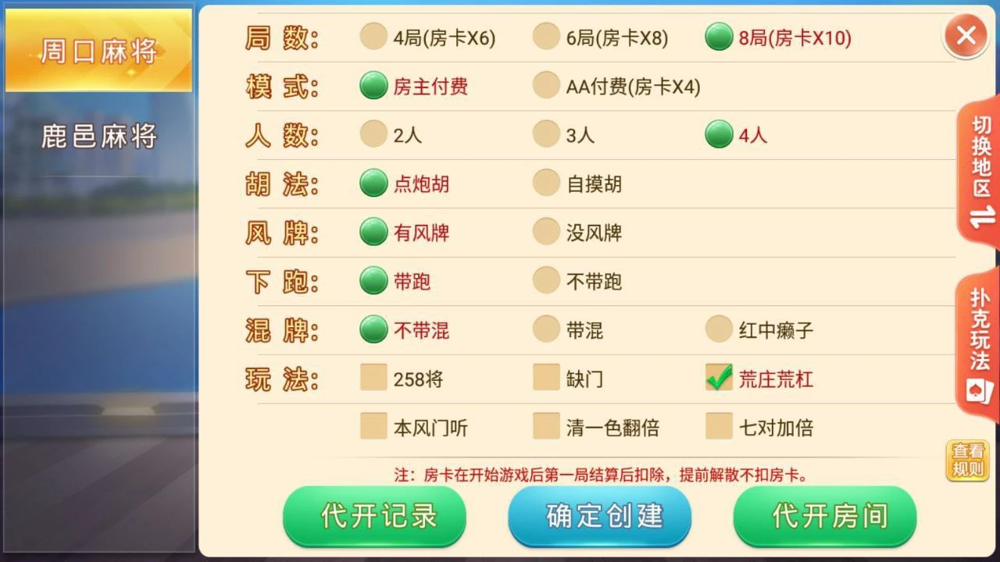

# 盛游河南：地方玩法目录与关键词检索

盛游河南包含周口麻将、鹿邑麻将、郑州麻将、开封麻将等地方玩法，也包括斗地主和跑得快的不同版本。地方玩法数量较多时，大厅需要兼顾熟悉地区的用户与只记得游戏名称的用户：地区地图便于逐级选择，名称检索便于快速定位。

本文结合大厅、地区选择和房间配置三个界面，介绍一种地区筛选与名称检索的实现方式。配套 JavaScript 代码为独立教学示例，不是原游戏工程。

## 游戏大厅

大厅将游戏群、创建房间和加入房间作为主要入口，战绩、规则、邮箱与设置位于底部。


此图头像、昵称与ID已经替换为示例内容，采用AI编辑，并非逐像素原始截图。

## 地区选择

地图按地区组织入口，左侧区分麻将与扑克玩法。地区名称是导航条件，不能直接替代具体玩法标识：同一地区可以包含多种规则。


## 麻将房间

周口麻将配置页包含局数、人数、胡法、风牌及附加玩法等选项。地方规则较多时，应把目录导航与房间参数分开管理，先确定玩法，再展示该玩法支持的选项。



## 目录字段

用于展示的目录可以保留三个基础字段。地区相同的条目仍拥有各自的稳定标识，列表顺序由目录配置决定。

| 字段 | 示例 | 说明 |
| --- | --- | --- |
| id | luyi | 程序使用的稳定标识 |
| name | 鹿邑麻将 | 用户看到的名称 |
| region | 周口 | 地区筛选条件 |

示例标识及地区分组由本文定义，用来说明检索方式，不代表原工程的数据结构或通信协议。用户切换地区时，界面应清楚显示当前筛选条件，避免将“没有匹配结果”误认为整个目录没有该游戏。

## 独立示例

关键词去除首尾空格后进行包含匹配；地区按完整名称匹配。两个条件同时提供时，结果必须同时满足。留空则不限制对应条件。

```js
export function searchGames(games, {keyword = '', region = ''} = {}) {
  if (typeof keyword !== 'string' || typeof region !== 'string') {
    throw new TypeError('关键词与地区必须是字符串');
  }
  const query = keyword.trim();
  const area = region.trim();
  return games
    .filter(game => (!query || game.name.includes(query)) &&
      (!area || game.region === area))
    .map(({id, name, region}) => ({id, name, region}));
}
```

例如，目录包含周口麻将、鹿邑麻将与郑州麻将时，`{region: '周口'}` 返回前两项；增加 `keyword: '鹿邑'` 后只保留鹿邑麻将。搜索不会重新排序，也不会修改原始条目。

实现见 [search.mjs](search.mjs)，测试见 [test.mjs](test.mjs)。安装 Node.js 后运行：

```sh
node test.mjs
```

测试覆盖空条件、中文关键词、地区过滤、组合条件、无匹配、空目录、空白字符、输入类型及对象隔离，共11项断言。

## 接入界面

搜索函数面向已经校验过的目录数据，调用前应确保每项包含合法的 `id`、`name` 和 `region`。显示结果时使用稳定标识绑定事件，不能用筛选后的列表下标代表玩法。用户清空关键词后，原始排序仍然有效。

在界面上可以同时显示匹配数量和当前地区，并提供清除筛选入口。较小目录可在本地完成检索；若使用远程搜索，应处理请求返回顺序，避免旧查询结果覆盖新输入。

目录筛选只决定展示哪些入口。创建房间时，服务端仍需检查玩法开放状态、人数、局数和选项组合。客户端隐藏某个选项不能替代服务端校验。本文未运行原游戏工程，不对其服务端实现或部署状态作推断。

## 技术交流

[Telegram @root4433](https://t.me/root4433)
